# fluidsynth-scripts

[](https://github.com/aljazmc/fluidsynth-scripts/actions/workflows/ci.yml)
[](LICENSE)
[](https://www.fluidsynth.org/)
[](https://numpy.org/)
[](https://ffmpeg.org/)
[](https://www.python.org/)
[](https://github.com/astral-sh/ruff)
[](https://www.shellcheck.net/)
[](https://www.conventionalcommits.org/)

Music and soundscapes written as code. Python scripts write MIDI for
FluidSynth's General MIDI instruments and synthesize sound with NumPy, and a
shell script encodes the result with FFmpeg into WAV, FLAC, MP3, Opus, MP4
video and 17 other formats. 508 projects: eight arrangements of classical
music and 500 ambient soundscapes.

[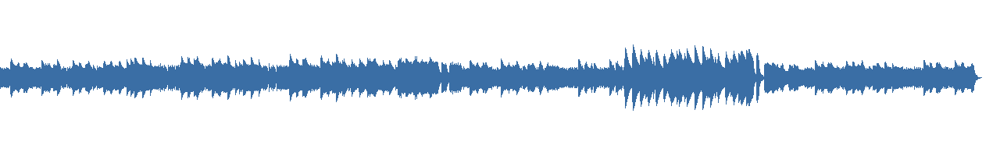](gallery/beethoven-fur-elise.mp4)

▶ [beethoven-fur-elise.mp4](gallery/beethoven-fur-elise.mp4) (2:56), exported
with `./project.sh simplified/beethoven-fur-elise mp4` and the FluidR3_GM
soundfont.

## Gallery

The ten takes of `soundscapes/cyberpunk-neon`, as videos with a scrolling
spectrogram above the waveform of each channel, made with
`./project.sh <project> mp4`. Click a picture to watch.

| | |
| --- | --- |
| [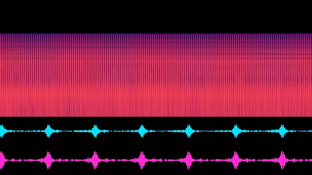](gallery/cyberpunk-neon00.mp4)<br>[`cyberpunk-neon00`](gallery/cyberpunk-neon00.mp4) (0:40): A neon sign buzzing in an alley | [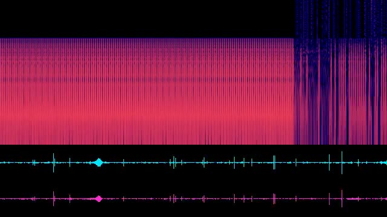](gallery/cyberpunk-neon01.mp4)<br>[`cyberpunk-neon01`](gallery/cyberpunk-neon01.mp4) (0:40): A flickering, failing sign |
| [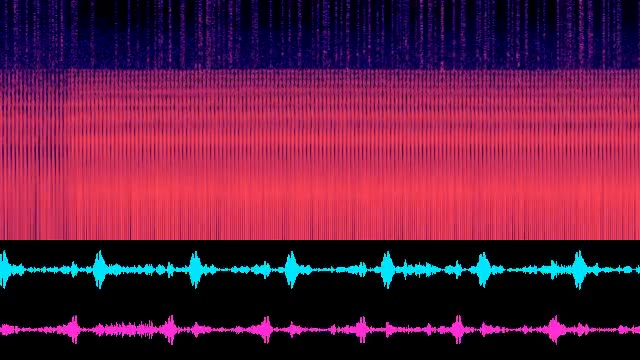](gallery/cyberpunk-neon02.mp4)<br>[`cyberpunk-neon02`](gallery/cyberpunk-neon02.mp4) (0:45): A street of neon in the rain | [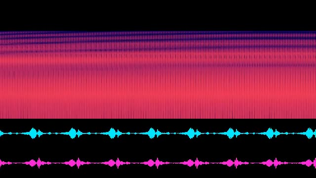](gallery/cyberpunk-neon03.mp4)<br>[`cyberpunk-neon03`](gallery/cyberpunk-neon03.mp4) (0:40): Under a huge sign, the buzz all around |
| [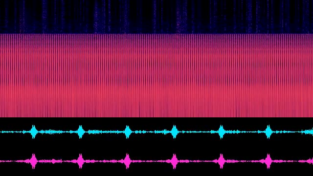](gallery/cyberpunk-neon04.mp4)<br>[`cyberpunk-neon04`](gallery/cyberpunk-neon04.mp4) (0:40): A shorting sign spitting sparks | [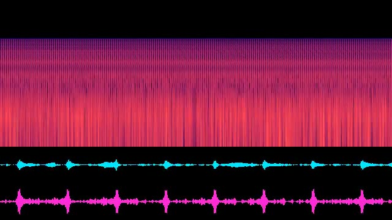](gallery/cyberpunk-neon05.mp4)<br>[`cyberpunk-neon05`](gallery/cyberpunk-neon05.mp4) (0:45): A quiet backstreet, one dim sign |
| [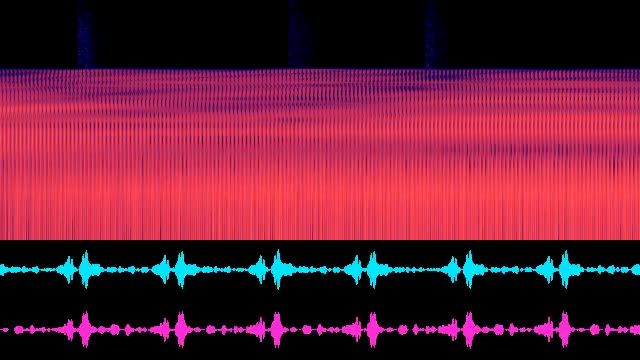](gallery/cyberpunk-neon06.mp4)<br>[`cyberpunk-neon06`](gallery/cyberpunk-neon06.mp4) (0:45): A night market strip of signs | [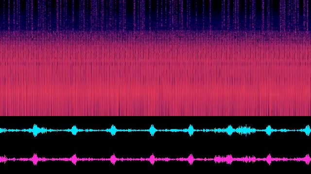](gallery/cyberpunk-neon07.mp4)<br>[`cyberpunk-neon07`](gallery/cyberpunk-neon07.mp4) (0:45): A rooftop sign in the wind and rain |
| [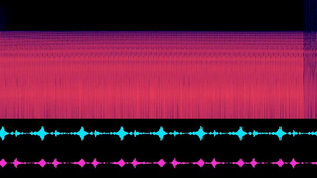](gallery/cyberpunk-neon08.mp4)<br>[`cyberpunk-neon08`](gallery/cyberpunk-neon08.mp4) (0:40): A motel sign, flicker and hum | [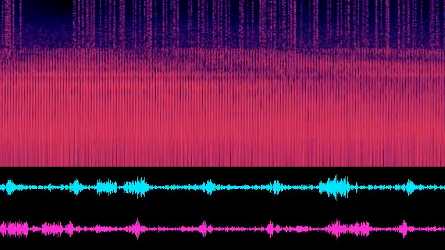](gallery/cyberpunk-neon09.mp4)<br>[`cyberpunk-neon09`](gallery/cyberpunk-neon09.mp4) (0:45): An arcade front, signs buzzing in a downpour |

## Features

- **508 projects.** Für Elise and Holst's *The Planets* in simplified
  arrangements, and fifty ambient scenes in ten takes each, from rain and
  whales to maglev trains and clockwork.
- **A text notation for music.** Notes, chords, ties, staccato, accents,
  dynamics with hairpins, meters and pedal changes, written bar by bar as
  text and played through FluidSynth.
- **Synthesis with NumPy.** Noise, filters, oscillators, panning and reverb,
  with every source placed by position, distance and timing.
- **22 outputs.** PCM, lossless and lossy formats encoded by FFmpeg from 48
  kHz stereo floats, an MP4 video of the spectrogram and waveform, and the
  raw NumPy array for further processing.
- **Reproducible takes.** Each soundscape starts with its settings and a
  random seed; change the seed for another take of the same scene.

## Quick start

```sh
git clone https://github.com/aljazmc/fluidsynth-scripts.git
cd fluidsynth-scripts
./project.sh simplified/beethoven-fur-elise mp3
```

The audio is written to `build/beethoven-fur-elise.mp3`.

## Requirements

| Requirement | Notes |
| --- | --- |
| Python 3 | with [NumPy](https://numpy.org/) |
| FluidSynth | `fluidsynth` on the `PATH` |
| A General MIDI soundfont | by default `/usr/share/sounds/sf2/FluidR3_GM.sf2` (on Debian and Ubuntu, the `fluid-soundfont-gm` package); set `SOUNDFONT` to use another one |
| FFmpeg | `ffmpeg` on the `PATH`, built with the encoders of the formats you want (`libmp3lame`, `libvorbis`, `libopus`, `libx264`, …) |

## Usage

```sh
./project.sh <project> <format>          # build one format
./project.sh <project> all               # build every format
./project.sh all <format>                # build every project
./project.sh <group> all <format>        # build every project of a group
./project.sh <project> <format> clean    # remove one output
./project.sh <project> clean             # remove all outputs of a project
./project.sh clean                       # remove build/ and npy/
```

For example:

```sh
./project.sh simplified/beethoven-fur-elise mp3
./project.sh soundscapes all flac
SOUNDFONT=/usr/share/sounds/sf2/TimGM6mb.sf2 ./project.sh simplified/beethoven-fur-elise wav
```

A project is named by its path inside `scripts/`, and a group is a folder of
projects, such as `simplified` or `soundscapes`. Outputs stay flat:
`simplified/<name>` goes to `build/<name>.<format>`, and other groups keep
their name as a prefix, e.g. `soundscapes/nature-rain00` goes to
`build/soundscapes-nature-rain00.<format>`. Existing outputs are skipped, so
clean them to rebuild. Run `./project.sh` from the repository root. Without
arguments, it prints the usage with every format and group and the first ten
projects; `ls scripts/*/` lists them all.

### Formats

All audio is rendered as 48 kHz stereo floats and encoded by FFmpeg:

| Kind | Formats |
| --- | --- |
| PCM | `wav` and `au` (16-bit), `aiff`, `caf` and `w64` (24-bit) |
| Lossless compressed | `flac` (24-bit), `mka` (FLAC in Matroska), `alac`, `tta`, `wv` |
| Lossy | `aac` and `m4a` (AAC), `ac3`, `dts`, `eac3`, `mp2`, `mp3`, `ogg` (Vorbis), `opus`, `wma` |
| Video | `mp4` (H.264 spectrogram and waveform, AAC audio) |
| Raw | `npy` |

- `mp4` is a 640x360 video at 15 fps: a scrolling spectrogram above the
  waveform of each channel, with the audio as 96 kbit/s AAC. The video
  bitrate is capped by the length so a file stays under about 5 MB.
- `alac` is written as `build/<name>-alac.m4a`, so it doesn't clash with
  `m4a`.
- `npy` saves the raw float32 array of shape `(frames, 2)` to
  `npy/<name>.npy`, to load it with `numpy.load()` and process it further.

## How it works

```
project.sh ──> python3 scripts/export<format>.py <project>
                                    │
                                    ▼
                             scripts/common.py
                                    │ load_project()
                                    ▼
    scripts/<project>/<name>.py: <name>() -> float array (frames, 2)
       │ Score: MIDI events ──> fluidsynth -F raw ──> NumPy
       │ and/or NumPy synthesis, mixing, reverb
                                    │ master(): -16 LUFS, -1 dBTP
                                    │ ffmpeg_export()
                                    ▼
                  ffmpeg -f f32le -i pipe:0 -c:a <codec> ...
```

- `project.sh` checks the arguments and runs `scripts/export<format>.py` (or
  `scripts/savenpy.py`) with the project as its argument.
- `scripts/common.py` imports the project, calls its function, checks the
  shape of the audio and masters it with `master()`: it brings the audio to
  an integrated loudness of -16 LUFS (ITU-R BS.1770, gated as in EBU R128)
  and limits its true peak, 4 times oversampled, with a look-ahead limiter,
  so every project plays at the same loudness and stays below -1 dBTP. It
  also holds the shared tools:
  `Score`, which collects notes and controller changes in seconds, writes
  them as a MIDI file and renders it offline with FluidSynth through the
  soundfont, and `fit()` and `normalize()` for NumPy audio.
- Each `scripts/export<format>.py` pipes the audio into FFmpeg with the
  codec and quality settings of one format.

## Projects

A project is a folder holding `<name>.py` with a function `<name>()`, where
`<name>` is the part of the folder name after its last hyphen. It returns a
float array of shape `(frames, 2)` at 48 kHz. A project needs nothing
outside its folder, apart from `scripts/common.py`.

### Simplified

Simplified arrangements of classical music in the public domain, played by
FluidSynth's General MIDI instruments:

```
scripts/simplified/beethoven-fur-elise/
├── elise.py   # elise(): tempi, dynamics and the order of the passages
├── piano.py   # a small text notation for piano music, played through Score
└── score.py   # the music, one notation string per bar
```

| Project | Played by |
| --- | --- |
| beethoven-fur-elise | piano |
| holst-the-planets-01-mars-the-bringer-of-war | orchestra |
| holst-the-planets-02-venus-the-bringer-of-peace | orchestra |
| holst-the-planets-03-mercury-the-winged-messenger | orchestra |
| holst-the-planets-04-jupiter-the-bringer-of-jollity | orchestra |
| holst-the-planets-05-saturn-the-bringer-of-old-age | orchestra |
| holst-the-planets-06-uranus-the-magician | orchestra |
| holst-the-planets-07-neptune-the-mystic | orchestra |

The notation (see the docstring of `piano.py`) writes notes, chords, rests,
ties, staccato, accents, dynamics with hairpins, meters and pedal changes as
text, e.g. `!mf c4 eb4:1/2 f#3+a3+d4:1.5 |`. The scores were transcribed
bar by bar from braille music. `orchestra.py` gives each part its own
General MIDI instrument, channel and pan; sustained instruments follow the
dynamics through MIDI expression (CC11), struck and plucked ones through
note velocity.

### Soundscapes

Fifty ambient scenes in three themes, each in ten takes (`00` to `09`),
named `soundscapes/<theme>-<scene><take>`:

<details>
<summary>3 themes, 50 scenes</summary>

| Theme | Scenes |
| --- | --- |
| cyberpunk | club, drones, factory, maglev, neon, reactor, servers, streets, terminal, traffic |
| nature | bamboo, bees, campfire, cave, chirping, cicadas, crickets, dunes, frogs, geese, geyser, hail, ice, jungle, loons, owls, rain, rockfall, savanna, seals, stags, stream, thunderstorm, volcano, waterfall, waves, whales, whitewater, wind, wolves |
| steampunk | airship, automaton, boiler, calliope, clockwork, engine, foundry, locomotive, telegraph, workshop |

</details>

Each soundscape is a single file that starts with its settings: length,
random seed, fades, levels, and the position, distance and timing of each
sound source. Most are synthesized with NumPy alone (noise, filters,
oscillators, panning and reverb); `chirping`, `waves` and `calliope` also
play General MIDI instruments through `Score`. Change the `SEED` for another
take of the same scene.

## Tests

```sh
for test in tests/sh/test_*.sh; do bash "$test"; done   # project.sh
python3 -m unittest discover tests/py           # the Python scripts
RENDER=all python3 tests/py/test_audio.py       # render every project and check how it sounds
RENDER='soundscapes/cyberpunk-*' python3 tests/py/test_audio.py
```

The tests need bash, Python and NumPy, and the loudness and frequency
tests need FFmpeg too. None of them writes outputs, and only the loudness
and frequency tests on the projects render anything.

The tests of `project.sh` run it in a temporary sandbox, with a few fake
projects and stand-ins for `python3`, `fluidsynth` and `ffmpeg` (see
`tests/sh/lib.sh`), so they never touch `build/` or `npy/`:

- `tests/sh/test_project.sh` checks that `project.sh` rejects bad arguments
  with its usage and exit code 1.
- `tests/sh/test_formats.sh` checks that the formats of `project.sh`, the
  exporters in `scripts/` and the Formats table of this README agree, and
  that each exporter writes its own extension.
- `tests/sh/test_outputs.sh` checks the names of the outputs, as described
  under Usage, through the `clean` commands.
- `tests/sh/test_run.sh` checks that `project.sh` runs the right exporter
  for a project, a group and `all`, skips existing outputs, reports a
  failed export with exit code 1 and stops when a program is missing.

The Python tests:

- `tests/py/test_projects.py` reads every project without running it: each
  has its `<name>()` function, imports only the standard library, NumPy,
  `common` and its own modules, and each soundscape takes its randomness
  from one `default_rng(SEED)`, has sensible settings, and comes in ten
  takes with seeds of their own. It also checks the counts of projects in
  this README.
- `tests/py/test_notation.py` checks the notation of `piano.py` (pitches,
  chords, durations, ties, dynamics, meters, tempo), and plays every
  arrangement with FluidSynth swapped for a recorder of the MIDI events:
  every bar must fill its meter, and every event must be valid MIDI with
  each note started and stopped. It needs neither FluidSynth nor a
  soundfont.
- `tests/py/test_midi.py` reads back the files `write_midi()` writes, with
  a small parser of the Standard MIDI File format, and checks the events
  of `Score`.
- `tests/py/test_common.py` checks `varlen()`, the MIDI variable-length
  numbers, against the examples in the Standard MIDI File specification,
  and the mastering: `loudness()` against the levels of test tones in
  ITU-R BS.1770, and that `limit()` and `master()` keep the true peak below
  the ceiling.
- `tests/py/test_audio.py` checks that a project suits typical laptop
  speakers. It measures it with FFmpeg's EBU R128 meter (ITU-R BS.1770),
  first as it is and then through filters that drop what small drivers
  can't play, below 150 Hz and above 16 kHz (24 dB per octave):

  | Check | Limit |
  | --- | --- |
  | Integrated loudness | -20 to -12 LUFS |
  | True peak | at most -1 dBTP |
  | Loudness range | at most 15 LU |
  | Loudness lost without the bass below 150 Hz | at most 6 LU |
  | Loudness lost without what lies above 16 kHz | at most 0.5 LU |

  The checks on the meter itself, with test tones, always run. The checks
  on the projects render them, so they only run with `RENDER` set to `all`
  or to a pattern of projects; `JOBS` sets how many render at once.

Lint the code with [ShellCheck](https://www.shellcheck.net/) and
[Ruff](https://docs.astral.sh/ruff/):

```sh
shellcheck project.sh tests/sh/*.sh
ruff check .
```

GitHub Actions runs both on every push and pull request, see
[.github/workflows/lint.yml](.github/workflows/lint.yml).

## License

The scripts are licensed under the [MIT License](LICENSE). The files in
`gallery/` were made with them and are under the same license. The music
they arrange (Beethoven, Holst) is in the public domain.

The scripts drive software and use sounds that are not part of this
repository and have licenses of their own:

- [FluidSynth](https://github.com/FluidSynth/fluidsynth/blob/master/LICENSE)
  is licensed under the GNU Lesser General Public License, version 2.1 or
  later. The scripts only run it as a separate program.
- Soundfonts: the default
  [FluidR3_GM](https://packages.debian.org/stable/fluid-soundfont-gm)
  soundfont by Frank Wen is licensed under the MIT license. Other
  soundfonts have their own licenses, e.g. TimGM6mb is under the GNU GPL,
  version 2; check the license of the soundfont you use before you publish
  what you render with it.
- [NumPy](https://numpy.org/doc/stable/license.html) is licensed under the
  BSD 3-Clause license.
